[Portfolio](https://rahul-pai.vercel.app/) · [Hugging Face](https://huggingface.co/RahulPi) · [PyPI](https://pypi.org/user/RahulGPi/) · [LinkedIn](https://www.linkedin.com/in/rahul-pai17/)

I build language model inference tools and interfaces for working with data. My projects range from CPU attention kernels to databases you can query by voice.

## Release

**[tri-tier 0.1.0](https://pypi.org/project/tri-tier/0.1.0/)** · September 27, 2026 
A tiered KV cache for long-context inference on consumer CPUs. [Benchmarks](https://github.com/RahulGPi/TriTierCache/tree/main/benchmarks)

## Selected work

  
  

  
  

  
  

## Open source

**[Narwhals](https://github.com/narwhals-dev/narwhals/pull/4182)** · Proposed Polars support for `map.len()` to count entries in a map column.

