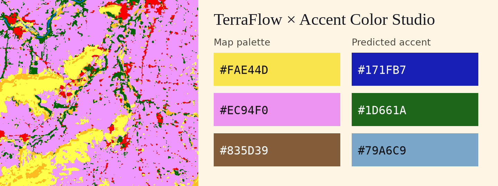
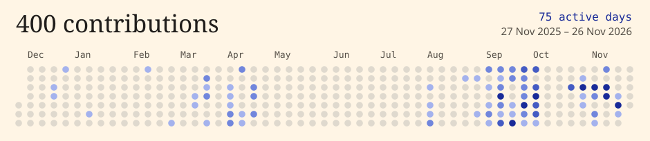

I build language models and data tools in Mangaluru. I study computer science and AI at Sahyadri, and my internship work has taken me from retrieval pipelines at Datavex.ai to model hosting at MResult. My own projects usually start with something I want to try for myself.

[Portfolio](https://rahul-pai.vercel.app/) · [Models on Hugging Face](https://huggingface.co/RahulPi) · [PyPI](https://pypi.org/user/RahulGPi/) · [LinkedIn](https://www.linkedin.com/in/rahul-pai17/)

## Selected work

**Can you design a database by talking to it?**

With Agentic DBMS, you can sketch tables on a canvas, describe how they relate, and ask questions about the data. A local language model uses the PostgreSQL schema to translate a request into SQL. [Agentic DBMS](https://github.com/RahulGPi/Agentic-DBMS)

**Can a small neural network learn to pick an accent color?**

I wrote a network in NumPy that takes three RGB values and predicts three more. The playground lets you watch the neurons activate, extract a palette from an image, and try the result on UI components. [Accent Color Studio](https://github.com/RahulGPi/ML_UI-Color-Picker)

**What can satellite imagery tell us about a potential building site?**

Our TerraFlow prototype brings Landsat imagery and land-cover maps into the same site-selection workflow. Below, I ran one of its map exports through Accent Color Studio. The yellow cluster produced a deep blue accent. [TerraFlow](https://github.com/RahulGPi/TerraFlow)

Map adapted from ESA WorldCover 2021 v200, © ESA WorldCover Consortium. <a href="https://doi.org/10.5281/zenodo.7254221">Dataset</a> · <a href="https://creativecommons.org/licenses/by/4.0/">CC BY 4.0</a>

More experiments

- **SOLO** searches its SQLite conversation history when you ask about something you discussed earlier. [Repository](https://github.com/RahulGPi/ExtremelyFastAgent)
- **Pixie** is a team-built virtual dog companion. Completing real-world tasks earns food and care for the dog. [Repository](https://github.com/RahulGPi/Pixie)
- **FinQA distillation** collects model responses to financial reasoning questions and pairs them with reference answers for training data. [Repository](https://github.com/RahulGPi/Multi-Provider-Distillation-Pipeline)

## Models and releases

| Release | What it does |
| --- | --- |
| [tri-tier 0.1.0](https://pypi.org/project/tri-tier/0.1.0/) · Sep 2026 | Compresses older entries in a language model’s KV cache to reduce memory use during CPU inference. [Benchmarks](https://github.com/RahulGPi/TriTierCache/tree/main/benchmarks) |
| [Qwen SQL Assistant](https://huggingface.co/RahulPi/qwen2.5-1.5B-sql) · Aug 2026 | A 1.5B-parameter Qwen model I fine-tuned with QLoRA to turn a question and a table schema into SQL. |
| [Email Text Formatter](https://huggingface.co/RahulPi/Email_Text_Formatter) · Oct 2025 | A Phi-4 fine-tune that extracts business assets mentioned in an email and returns structured records. |

## Research

For IEEE CONECCT 2026, we studied how much effort it takes to turn a database idea into a working schema. Fifteen participants tried both workflows. In our study, the same tasks took **73% less time** with the combined voice and visual interface.

*Multimodal Database Modeling* · With Vineeth KHM, Chirag Shetty, Gautham Nayak, and Chaitrika Aditya. [Paper](https://doi.org/10.1109/CONECCT68978.2026.11700597) · [Author PDF](https://rahul-pai.vercel.app/api/papers/1/download)

## Open source

I proposed `map.len()` support for the Polars backend in Narwhals. It lets you ask how many entries each map contains using the same dataframe API. [Narwhals PR #4182](https://github.com/narwhals-dev/narwhals/pull/4182)

Updated daily from GitHub, through the previous UTC day. <a href="https://github.com/RahulGPi?tab=overview">Live activity</a>
