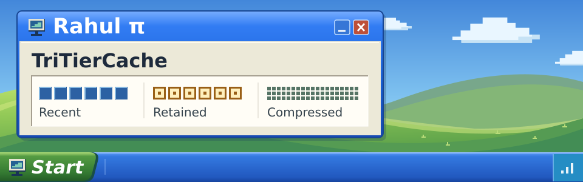

I build language models, inference tools, and the interfaces around them.

**[TriTierCache](https://pypi.org/project/tri-tier/)** · **[SQL Assistant](https://huggingface.co/RahulPi/qwen2.5-1.5B-sql)** · **[Agentic DBMS](https://github.com/RahulGPi/Agentic-DBMS)**

[Portfolio](https://rahul-pai.vercel.app/) · [Hugging Face](https://huggingface.co/RahulPi) · [LinkedIn](https://www.linkedin.com/in/rahul-pai17/)
